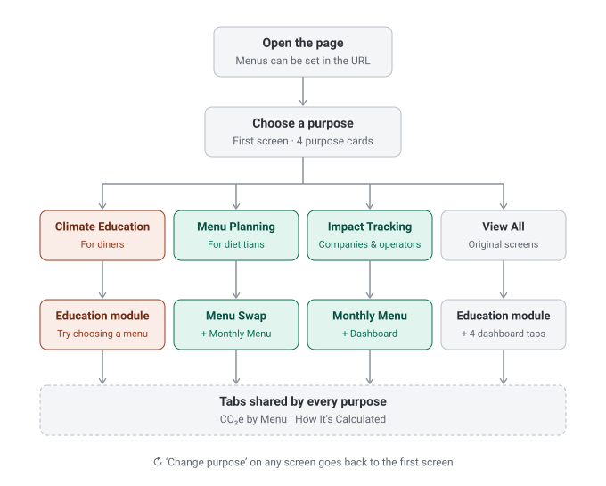
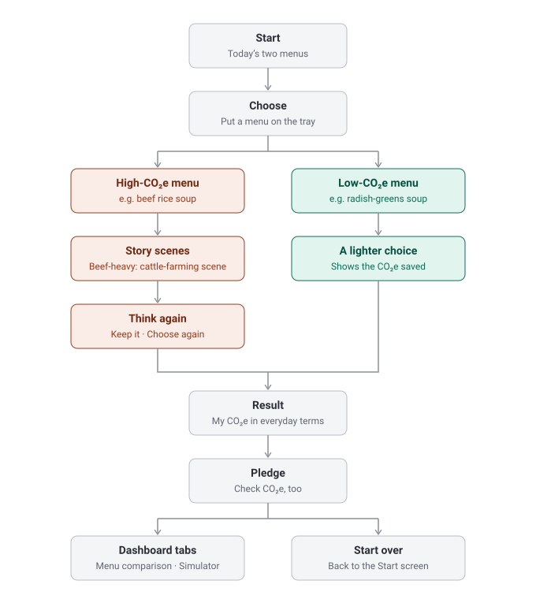
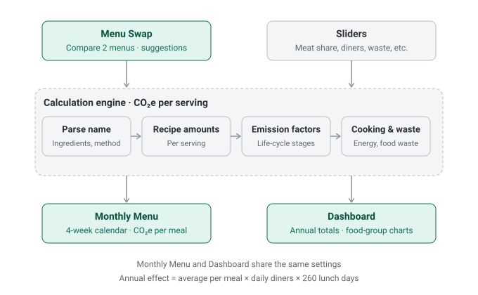

[한국어](README.md) | **English**

# Lunch Choices for the Planet

A web page that calculates and shows the CO₂e (greenhouse gas emissions) of workplace cafeteria lunch menus, starting from just the menu name.
When you choose a purpose on the first screen, only the screens needed for that purpose open.

We publish the code, public data and build documents together so that other schools, institutions and companies can build the same thing.

**[Open the site →](https://andyson114.github.io/pulcourse_new/en/)** (English) · [Korean site](https://andyson114.github.io/pulcourse_new/)

## Screens by purpose



| Purpose | For | Screens included |
|---|---|---|
| Climate Education | diners | Education module |
| Menu Planning | dietitians | Menu Swap, Monthly Menu |
| Impact Tracking | companies & operators | Monthly Menu, Dashboard |
| View All | everyone | Education module + 4 dashboard tabs (the original screens) |

- Every purpose also includes the 'CO₂e by Menu' and 'How It's Calculated' tabs.
- Press 'Change purpose' on any screen to go back to the first screen.

## Education flow for diners



- If you put a high-CO₂e menu on your tray, story scenes about its ingredients and the environment follow; if you choose a low-CO₂e menu, a screen shows how much you saved.
- The cattle-farming scene appears only when beef makes up 50% or more of the chosen menu.
- Press 'Let me choose again' to go back to the Choose screen.

## How it's calculated



1. Split the menu name into ingredients and a cooking method. (e.g. 소고기국밥 (beef rice soup) → 소고기 (beef) · 국밥 (rice-soup method))
2. Take the per-serving amount of each ingredient from the recipes in existing menu data.
3. Multiply by each ingredient's emission factor per 1 kg (production, processing, distribution, disposal).
4. Add emissions from cooking energy and food-waste treatment.
5. Multiply the per-serving value by the number of daily diners and the number of lunch days (52 weeks × 5 days = 260 days) to get the annual effect.

The Monthly Menu and the Dashboard share the same slider settings. A change on one side is reflected on the other.

## Opening with today's menu

Add menu names to the address to change the two menus shown in the education module.

```
https://andyson114.github.io/pulcourse_new/en/?a=김치볶음밥&b=순두부찌개&d=Sept%2021
```

- `a`, `b`: two menu names. Order does not matter; the one with higher CO₂e automatically becomes the first menu.
- `d`: date text shown on the Start screen (optional).
- If a name cannot be found in the data, the page opens with the default menus (소고기국밥 beef rice soup, 시래기국 radish-greens soup).
- `a` and `b` take Korean menu names (here 김치볶음밥 kimchi fried rice and 순두부찌개 soft tofu stew) or, on the English page, the English names from its menu list, e.g. `?a=Kimchi%20fried%20rice&b=Soft%20tofu%20stew`. The calculation engine works on the Korean names; the English page shows English names where a display name exists. Korean names also work on the Korean site without `/en/`.

## Public materials

| Material | Location | Contents |
|---|---|---|
| Build guide | [docs/BUILD_GUIDE.en.md](docs/BUILD_GUIDE.en.md) | File structure, unpack · edit · repack, switching to your own cafeteria's data, deployment |
| Data guide (Korean) | [docs/DATA.md](docs/DATA.md) | Structure, units and disclosure scope of each calculation data item; how to fill it with your own data |
| Methodology | [docs/METHODOLOGY.en.md](docs/METHODOLOGY.en.md) | Formulas for CO₂e per serving and the annual effect, limitations, sources |
| Public data | [data/](data/) | Emission factors for 130 ingredients (JSON · CSV), 19 calculation parameters, 12 sources, menu-name parsing dictionary |
| Source | [src/build/](src/build/) · [src/build-en/](src/build-en/) · [src/readable/](src/readable/) | Unpacked pieces of the app (shell, code, fonts, images), the translated English pieces, and readable code |
| Tools | [tools/](tools/) | Unpack (`unpack.py`), pack (`pack.py`), compare (`verify.py`), export public data (`export_public_data.py`) |

The emission factor table opens directly in Excel: [data/emission_factors.csv](data/emission_factors.csv)

## Build it yourself

All you need is Python 3 (nothing else to install).

```bash
# 1. After editing the pieces, pack them again (point to the calculation data file you prepared)
python3 tools/pack.py src/build index.html --payload my_payload.json

# 2. Compare with the previous file and check which pieces changed
python3 tools/verify.py before.html index.html
```

Some calculation data, such as recipe amounts, is not public, so you need to prepare it yourself. The required format and minimum set are in the [data guide](docs/DATA.md) (Korean), and the full procedure is in the [build guide](docs/BUILD_GUIDE.en.md).

## English version

The English app is a separate single file built from the same engine and data.

- `en/index.html` — the English app (single file), served at `/pulcourse_new/en/`.
- `src/build-en/` — translated pieces only: `shell.html`, `app.bundle.js`, `rolehub.js`, `rolehub.css`. Fonts, images (`assets/`) and `restaurant.svg` are shared from `src/build/`.
- `tools/pack.py` has a `--base DIR` option: any piece missing from the source folder is read from `DIR`.

```bash
python3 tools/pack.py src/build-en en/index.html --payload my_payload.json --base src/build
```

- The calculation data (payload, `data/`) stays Korean. The English page shows English names through a display-name dictionary (`EN_NAMES`) at the top of `src/build-en/app.bundle.js`; menu and ingredient names not in that dictionary are shown in Korean. The menu box on the English page accepts the English names from its list or any Korean menu name.
- Both pages have a language link (English / 한국어) on the first screen.
- Korean only: data files in `data/`, `docs/DATA.md` (dataset documentation), source titles and papers (S001–S015), and emission-factor notes.

## Data disclosure scope

| Category | Items | Source |
|---|---|---|
| Public | Emission factors, calculation parameters, source list, menu-name parsing rules and dictionary | Public materials such as papers, national statistics and IPCC (S001–S011), and rules made by the team |
| Not public | Recipe amount distributions, templates by cooking method, menu frequencies, portion multipliers by age and institution, product-name words | Caterer's internal cooking guidelines (S012, not public) |

Non-public items were not exported to files; only their structure is described in the [data guide](docs/DATA.md) (Korean).

## License

| Covers | Terms |
|---|---|
| Code (scripts in `index.html` and `en/index.html`, `src/`, `tools/`) | [MIT](LICENSE) |
| Data and documents (`data/`, `docs/`) | [CC BY 4.0](LICENSE-DATA.md) — free to use with attribution |
| Font (Noto Sans KR) | [SIL OFL 1.1](src/build/fonts/OFL.txt) |
| Institution and company logos | Marks of their respective owners; not covered by any license |

Terms of use for the original sources, and information on images and logos, are in [NOTICE.en.md](NOTICE.en.md) ([Korean](NOTICE.md)).

## Files

```
index.html              The whole app (single file) — deployed with GitHub Pages
en/index.html           The English app (single file) — served at /pulcourse_new/en/
README.en.md            This file (English version of README.md)
docs/                   Build guide, data guide, methodology, flowcharts (SVG)
docs/*.en.md            English versions of the docs (BUILD_GUIDE, METHODOLOGY); flowcharts in *.en.svg
data/                   Public data (JSON · CSV) and its list (MANIFEST.json)
src/build/              Pieces unpacked from index.html (shell, code, fonts, images)
src/build-en/           Translated pieces for the English app (fonts and images shared from src/build/)
src/readable/           Readable code (engine · dash · app)
tools/                  Unpack, pack, compare and data-export tools
LICENSE, LICENSE-DATA.md, NOTICE.md, NOTICE.en.md
```
